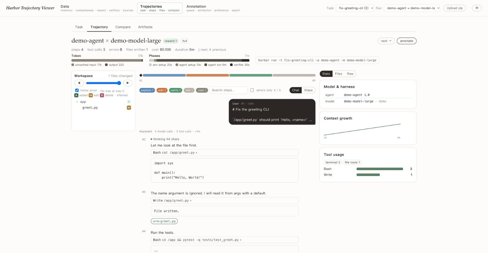

# Harbor Trajectory Viewer

A local web app for browsing, auditing and annotating [Harbor](https://harborframework.com) tasks and
[ATIF](https://docs.harborframework.com/agents/atif) agent trajectories.



## Run

```bash
npm install
npm run ingest        # normalises examples/demo-pack into data/
npm run dev           # http://localhost:5173
```

To load your own data, run `node scripts/ingest.mjs <dir>`. The directory can be a pack
(`tasks/<task>/jobs/<job>/`) or a Harbor jobs directory (`jobs/<job>/<trial>/`, with `--tasks <dir>`
pointing at the task definitions). The "Upload zip" button does the same for a zip file, inside the
browser. `npm run share` publishes the local server through a Cloudflare tunnel.

## Pages

**Data.** Task cards, import issues (missing or unparsable trajectories, missing rewards, agent metadata
conflicts, exceptions), reward spread per task, how each task is graded, totals by data source.

**Trajectories.** The task definition and the container file system as the agent saw it. A chat-style
replay of each run, with a file tree that follows the current step, a file pane with content and diffs,
a phase timeline, subagent trajectories, and the raw result and trajectory metadata. Side-by-side
comparison of two runs with their first divergence point. Artifact preview for images, video, audio,
PDF, xlsx and docx.

**Annotation.** Per run: a verdict, a verifier audit, failure localisation (first error, point of no
return, first visible symptom), reward gaming, verification quality, loops, side effects, configurable
axes and notes. Per step: a numeric stepwise reward, a flag and a note. Per pair of runs: a preference
and the decisive divergence step. A queue with filters, statistics and JSONL export. Labels are stored
per dataset in `annotations/`, or in the browser for uploaded zips. The axes can be edited in the same
file.

The interface is available in Chinese and English.

## Parsing

`src/lib/normalize.js` reads ATIF 1.0 to 1.8, including multimodal parts and subagent trajectories,
Harbor `result.json`, `ctrf.json` test results and Dockerfiles. Step kinds, file writes, repeated
actions and suspicious actions (edits to tests or the verifier, git history reads, skipped tests, public
network access) are inferred from tool calls and shell commands, and the interface marks them as
inferred.

## Limitations

- The file tree is rebuilt from the Dockerfile and the agent's own writes. Files produced by shell
  commands are unknown, and the file pane says when it is showing an older version.
- Annotations are written to a local file by the dev server. There is no multi-user store.
- Zips are parsed on the main thread and long trajectories are rendered in full. Large packs are
  paginated, but a single run with thousands of steps will be slow.

## Acknowledgements

[ATIF-trajectory-viewer](https://github.com/Slimshilin/ATIF-trajectory-viewer),
the [Harbor job viewer](https://docs.harborframework.com/results/view-job-results)
and [osverify.github.io](https://osverify.github.io/).

MIT License.
